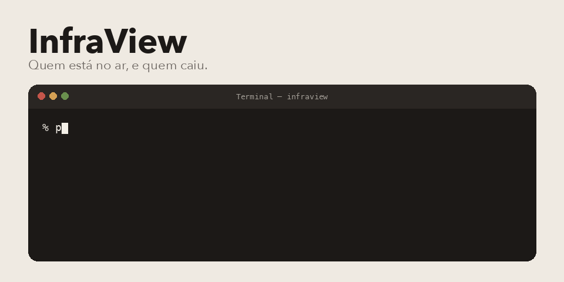

<p align="center">
  
</p>

InfraView é o painel de desktop onde eu olho servidor. Ping ICMP, e se o ICMP não responder, uma checagem TCP. Quando alguém cai, toca um aviso. Tem lista, histórico em gráfico e uma vista em colmeia.

Os endereços do gif são exemplo de tela, não um inventário real.

## Do que é feito

Python com PyQt5. Matplotlib desenha o histórico. SQLite guarda o que já foi visto, em `data/`. O empacotamento é PyInstaller, pelo `InfraView.spec`. Em `dist/` tem um `.exe` de Windows, e em `build/` um `.pkg`. Os dois passam de 50 MB, o GitHub aceitou com aviso.

## Subir daqui

```bash
python3 -m venv .venv
source .venv/bin/activate
pip install PyQt5 matplotlib mplcursors
python run.py
```

A janela abre pelo `core/main.py`, que o `run.py` chama. Servidor se adiciona na própria interface.

## Onde mexer

- `core/monitor.py` é o ping ICMP e o TCP.
- `core/database.py` é o SQLite.
- `gui/` é a janela, a colmeia e a edição de servidor.
- `assets/` são os ícones e o som de queda.

Pedro Américo Paletot, [peamericoo](https://github.com/peamericoo).
